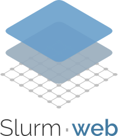
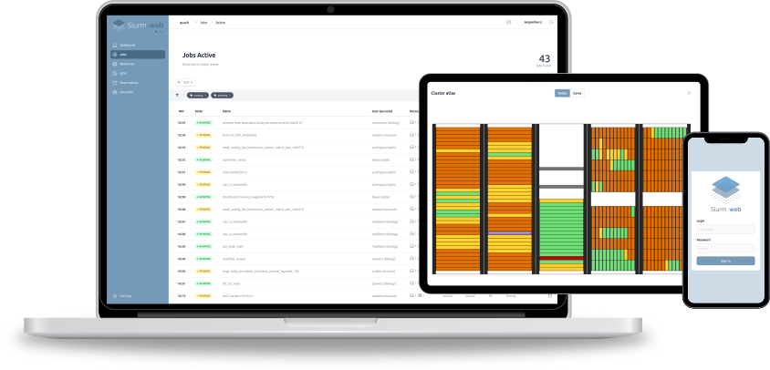
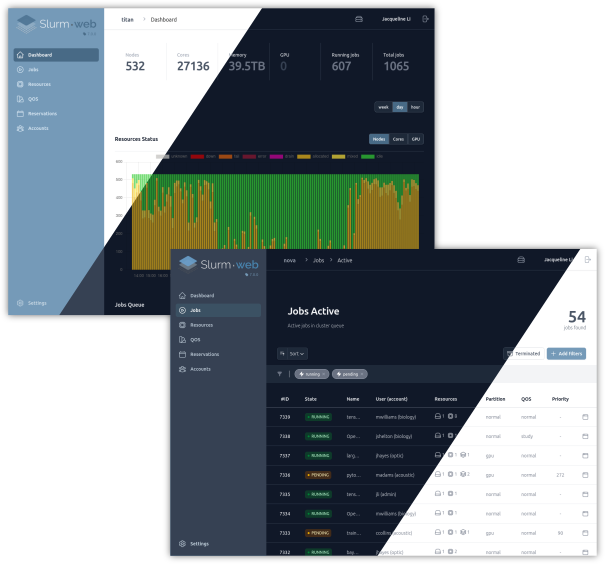

# Slurm-web

## Overview

Slurm-web is an open source web dashboard for Slurm based HPC clusters.

[Slurm](https://slurm.schedmd.com/) is the world leading workload manager for
HPC clusters with all most advanced features to manage jobs and resources
efficiently with a powerful command-line interface (CLI).

Slurm-web provides a clear graphical user interface with views to track your
jobs, intuitive insights and advanced visualizations on top of Slurm to monitor
status of HPC supercomputers in your organization, in a web browser on all your
devices.

Many features in a reactive & responsive web UI:

* Dashboard with interactive charts of resources and jobs status
* Instant jobs filtering and sorting
* Live jobs status update
* Colored badges to visualize job status at a glance
* GPU resources utilization monitoring
* Advanced visualization of node status with racking topology
* Intuitive visualization of account tree, QOS and advanced reservations
* Dark mode support
* Custom UI branding (colors, logos, favicon)
* Multi-clusters support
* LDAP authentication (including Active Directory support)
* SSO OpenID Connect (OIDC) authentication (ex: Keycloak, Authentik, etc)
* Advanced RBAC permissions management
* Transparent caching
* Integration with Prometheus to collect and chart timeseries metrics of Slurm

Get more details in
[Slurm-web advanced features overview](https://docs.rackslab.io/slurm-web/overview/overview.html).

## Quickstart

To install and start using Slurm-web in a few steps, follow the
[quickstart guide](https://docs.rackslab.io/slurm-web/install/quickstart/index.html)!
Containers and system packages are available for most Linux distributions for
easy installation and upgrade.

## Documentation

The [full documentation](https://docs.rackslab.io/slurm-web/) of Slurm-web is
available online with software architecture details, installation guide,
configuration references, troubleshooting guide, etc.

## Authors

Slurm-web is developed and maintained by [Rackslab](https://rackslab.io),
software editor of open source solutions designed to help HPC supercomputers
administration, operations and management.

## Support

Need help to deploy or setup Slurm-web? There are multiple ways to get technical
support.

### Professional

When uptime and response times matter, [Rackslab](https://rackslab.io) offers
[Enterprise and OEM licenses](https://slurm-web.com/pricing/) backed by an SLA:

* **Enterprise** — professional support with a service level agreement and a
  4-hour guaranteed response time (8×5 CET), for a fixed number of clusters and
  users (from 10 nodes and 10 users).
* **OEM** — the same support for integrators and vendors, with unlimited
  clusters and users, designed for custom integration.

With either license, you work with Rackslab's engineers, the people who build
and maintain the project. Their expertise covers Slurm-web in production and
the HPC clusters it is built for. Compare both offers on the
[pricing page](https://slurm-web.com/pricing/).

### Community

Multiple community channels are available to ask questions:

* **Matrix Chat** [#slurm-web:talk.rackslab.io](https://matrix.to/#/#slurm-web:talk.rackslab.io):
  instant messaging for quick feedback and help.

> [!NOTE]
> A [Matrix account](https://matrix.org/docs/chat_basics/matrix-for-im/#creating-a-matrix-account)
> is required to access the chat room. It can be created in few steps on any
> Matrix network public provider such as [matrix.org](https://matrix.org) or
> [gitter.im](https://gitter.im/#apps).

* [**GitHub Discussions Q&A**](https://github.com/rackslab/slurm-web/discussions/categories/q-a):
  post your questions with more context and details for more in-depth answers.

This support is provided by the community with best-effort participation of
Rackslab team. Please mind that people might not be available to answer your
questions.

## Sponsorship

If your organization uses Slurm-web, [become a sponsor](https://slurm-web.com/sponsors/)
at the bronze, silver, or gold level to fund its continued development.

Sponsors vote on [roadmap priorities](https://slurm-web.com/roadmap/), bringing
the needs of their HPC and AI users and administrators into development
decisions. Your organization's logo also appears on the project website,
giving visibility to your support and recognition for your contribution.

Sponsors make Slurm-web sustainable by funding the time needed to maintain
the software, fix bugs, and develop new features. Their support helps keep
the project actively maintained and freely available to everyone.

## Development

Want to contribute? Documentation to deploy a development environment is
available in
[development README.md](https://github.com/rackslab/slurm-web/blob/main/dev/README.md)

## License

Slurm-web is distributed under the terms of the MIT license.
